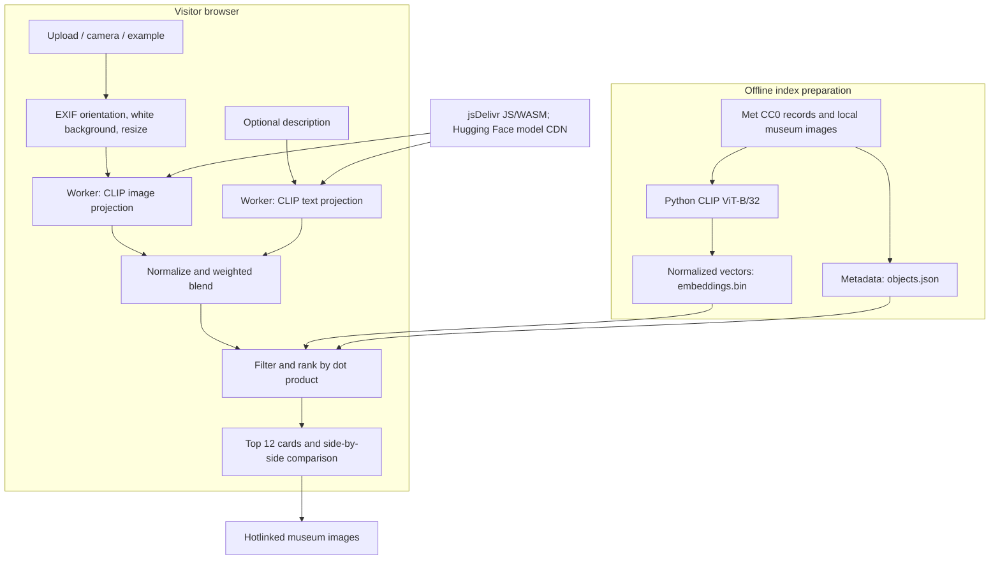

# Simili

Find visual connections between a photo of an object and The Met's Open Access
collection. This is a static HTML/CSS/JavaScript app in `public/`, with Italian
and English, mobile camera input, client-side filters, and a side-by-side view.
**CLIP is not a connoisseur:** it matches shape, color and style, not authenticity.
It provides no appraisal, provenance judgment or monetary value.


> **Demo GIF placeholder:** add `docs/demo.gif` showing photo → search → compare,
> then replace this block with ``. Use a photo you
> have permission to publish. No demo recording is supplied yet.

**Current state:** the app and index-building tools exist; the real museum index
and six example photos have not been supplied. The app reports missing data,
without invented matches. Fifteen-query relevance evaluation and the five-image
Python/browser consistency check remain unrun. See [evaluation](docs/evaluation.md).

## Run locally

Requirements: Node 20+ and Python 3.10+; CI uses Node 22 / Python 3.12.

```sh
npm run serve
# Run tests in another terminal:
node --test
python3 -m venv .venv
. .venv/bin/activate
python -m pip install -r requirements-dev.txt
python -m pytest -q
```

Open the server on port 8000. Use HTTP(S), not `file://`, for ES modules and
workers. No build or `npm install` is needed. Transformers.js is loaded at
runtime from a CDN. Use the existing checkout in cloud tasks; no worktree is
needed, and servers must restart in new tasks.

## How it works



Transformers.js **2.17.2** is pinned exactly (published 2024-05-29).
`Xenova/clip-vit-base-patch32` runs unquantized in a single-threaded WASM Web
Worker, without cross-origin isolation headers. Model files use browser cache
when available. The normalized query combines image and text embeddings;
blank text uses the image alone. Filters use exact metadata strings with AND
logic before top-12 selection. Percentages are cosine similarity, not confidence.

## Rebuild the index

1. Obtain actual Met API records and their permitted local images. Include only
   `isPublicDomain: true` records and preserve credit lines and source URLs.
2. Create a manifest with paths relative to the manifest file:

   ```json
   [{"image": "images/object.jpg", "object": {"objectID": 123, "isPublicDomain": true}}]
   ```

   This shows the structure only: supply the **full real API record**, including
   title, department, period, culture, date, image URL, museum URL and credit line.
3. Install the separate, heavier model-generation dependencies and generate:

   ```sh
   . .venv/bin/activate
   python -m pip install -r scripts/requirements.txt
   python scripts/build_catalogue.py /path/to/catalogue-manifest.json
   ```

4. Run the [five-image compatibility check](docs/index.md#cross-runtime-check).
   Every Python/browser cosine must exceed 0.98. Do not assume equivalence.
5. Deploy `public/data/objects.json` and `embeddings.bin` together. Rebuild both
   after changes to model, preprocessing, image order or collection membership.

The binary stores row-major little-endian float16, 512 values per object;
metadata array order is binary row order. Full schema, model pins and mismatch
troubleshooting are in [index documentation](docs/index.md).

## Privacy

Photo pixels and descriptions remain in browser memory and its worker; the app
has no upload endpoint or analytics. Only the language preference is stored in
local storage. Model files are cached separately from user photos.
Third parties still receive normal HTTP request metadata, including IP address:
jsDelivr serves JS/WASM, Hugging Face and its CDN redirects serve weights, and
The Met serves result images. No query photo/text is attached to those requests;
images use no-referrer requests. This assumes the documented third-party runtime
has not been compromised; version pinning is not a security guarantee.
Generated evaluation/consistency images become public if included in `public/`.
Publish only intentionally public samples; remove private fixtures before deploy.

## Limitations

* Similar forms, color palettes and photographic backgrounds can outrank
  historically related objects. A modern reproduction can resemble an original.
* Catalogue coverage determines what can be found. Department choices are
  [proposed, not yet curated](docs/decisions.md); quality has not been measured.
* Scores can be negative and are not calibrated probabilities. “Show me why”
  is a comparison view, not a causal explanation. Text works best in English
  and is truncated to CLIP's 77-token context.
* First use downloads roughly 600 MB of model weights. Some mobile browsers
  lack enough memory. Cache eviction/private browsing can force redownloads;
  complete offline use is not guaranteed and there is no service worker.
* JPEG, PNG, WebP and AVIF depend on browser decoding. HEIC/HEIF requires local
  JPEG export (iPhone: Camera → Formats → Most Compatible). Files above 40 MB
  or decoded images above 60 MP are rejected; valid inputs resize to 2048px.
  The browser may allocate the original before the pixel limit can be checked.
* JS/WASM versions and Python weights are pinned; the browser model revision
  currently follows upstream default. Pin a tested revision before a data release.

See [evaluation](docs/evaluation.md) for observed checks versus untested failure
hypotheses, and [release notes](docs/release-readiness.md) for size/load estimates.

## Examples and another museum

Replace the six disabled SVG placeholders with permitted photos in
`public/examples/`, setting each `photo` path in `public/src/examples.js`.
The hero and placeholder drawings are illustrations, not museum artworks.

Another museum needs an adapter mapping its records to the [schema](docs/index.md),
per-image rights checks, the same embedding recipe, and source-aware IDs/credits.
The current generator is **Met-specific** and checks `isPublicDomain`; do not
forge that field for another institution. Extend its rights validation explicitly.
Update `safeURL()` in `public/src/render.js` with that museum's precise HTTPS
image/page hosts, and update footer credits, privacy text and filters as needed.
For combined catalogues, implement unique source-qualified IDs (the current
schema accepts integer Met IDs) and retain per-source attribution. Run consistency
and relevance checks again. Another museum is not a drop-in supported backend.

## Deploy on GitHub Pages

1. In repository **Settings → Pages → Build and deployment**, select **GitHub
   Actions**. Check that Actions/Pages permissions are allowed for the repository.
2. Push to `main` or run **Deploy static app to GitHub Pages** manually.
   `.github/workflows/pages.yml` runs the reusable test job, then uploads only
   `public/` and deploys it with the official Pages actions; there is no build.
3. Confirm the workflow succeeds and use the URL shown by its deployment step.
   App/worker/data paths are relative, supporting project subpaths.
4. Verify a real upload/search/compare and image attribution on the deployed site.
   A deployed shell without the index does not establish working search.

CI also runs **pytest and node --test on every push**, plus pull requests.
Python CI tests exercise the report verifier; they do not download CLIP weights
or certify relevance. No publication or hosted load-time measurement was made here.

## Deploy on Vercel

Use the root `vercel.json` to publish `public/` as a static site, with no Python
backend or build step. See [Vercel setup and troubleshooting](docs/vercel.md).

## Credits and rights

Museum data/images: **The Metropolitan Museum of Art, Open Access (CC0)**.
[API documentation](https://metmuseum.github.io/) ·
[Open Access policy](https://www.metmuseum.org/about-the-met/policies-and-documents/open-access).
Retain the supplied credit lines. Only eligible public-domain images are covered;
CC0 does not grant museum trademarks or cover every museum image.
This is an independent project, not affiliated with The Met.

Transformers.js uses Apache-2.0; OpenAI CLIP uses MIT. Check the Xenova model
card, ONNX Runtime notices and all bundled third-party licenses before release.
Do not assume CC0 covers models, code, user/example photos or another museum.
**No project code license has been selected**; public hosting does not imply
permission to reuse the source. The owner must choose a license separately.
